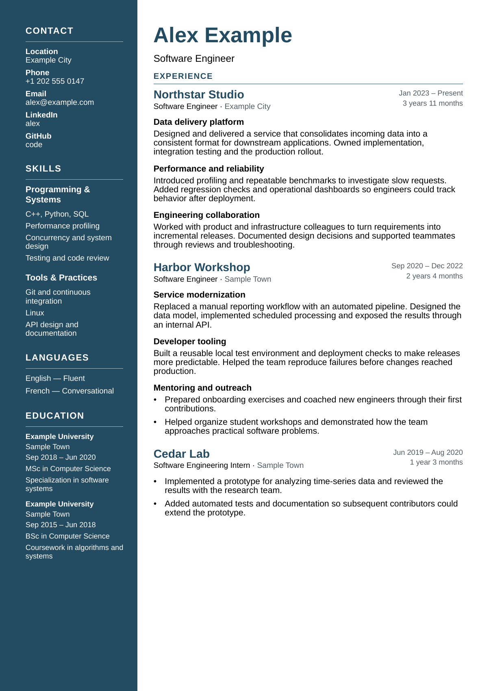

# FolioPress

**Your career in source. Your CV in print.**

Build a polished CV from structured career data, keep every version in Git, and
edit it directly from the command line or with any coding agent.

FolioPress is a standalone command-line CV builder powered by **Typst + Python**. It pairs a readable
sidebar template with bundled fonts, reproducible PDF builds, content checks and
persistent instructions for AI agents. You own the source and the output.

[View the example PDF](profiles/example/output/cv.pdf) · [Create your CV](#create-your-own-cv) · [Use any coding agent](#edit-with-any-coding-agent)



*Alex Example, the organizations and all career claims above are fictional. The
example demonstrates the layout; it is not a real person's CV.*

## Is this for you?

Use FolioPress if you want an editable, version-controlled CV rather than a PDF
that is difficult to update. It is especially useful if you already use GitHub,
Codex, Claude Code, Cursor, Copilot or another coding agent and want to tailor CVs for different roles.

You get:

- A polished A4 PDF with a contrasting sidebar and clearly separated employers.
- Structured profile data separate from the shared layout and build tools.
- Independent profiles and role-specific variants.
- Optional experience durations beneath employment dates.
- Pinned compiler and font files for repeatable rendering.
- Checks for missing text, page overflow, fonts and declared reading order.
- Agent instructions for factual accuracy, visual review and profile privacy.

This is a **source-first tool**, not a drag-and-drop editor or a job-application
service. You edit JSON yourself or ask an agent to edit it. You supply the facts;
FolioPress cannot verify career achievements or guarantee every ATS's behavior.
No AI subscription or API key is required to generate PDFs. AI assistance is optional.

## Try the example

Requirements: **Python 3.10+**, Git, and **Poppler** (`pdfinfo`, `pdftotext`,
`pdffonts`, `pdftoppm`, `pdftohtml`). On Ubuntu/Debian, Poppler is packaged as `poppler-utils`;
on macOS it is `poppler` in Homebrew. Install missing dependencies with your normal
package manager. No pip packages are needed.

```sh
git clone https://github.com/pedrorsmoreira/foliopress.git
cd foliopress
python3 bootstrap.py
bash build.sh --profile profiles/example
```

Open `profiles/example/output/cv.pdf`. All-page previews and extracted text are
created in `profiles/example/output/previews/` for inspection.

Bootstrap uses a matching installed Typst or downloads the **official pinned
Typst 0.15.1** release into `.tools/bin/`, verifies its SHA-256, and changes no
system directories. Linux/macOS on x86-64 and ARM64 are supported by the bootstrap;
other platforms need the exact compiler and PDF tools installed manually.
After setup, builds run offline from local files. FolioPress does not call service
or model APIs and requires no API keys, provider integration or hosted backend.
A coding agent can operate its files and commands using the agent’s own setup.

## Create your own CV

1. On GitHub, choose **Use this template → Create a new repository** and select
   **Private** for your personal workspace. Clone that new repository locally.
2. Create an independent profile:

   ```sh
   python3 new_profile.py alex-smith --name "Alex Smith" --title "Software Engineer"
   ```

3. Fill `profiles/alex-smith/profile.json` with your own confirmed information.
   The scaffold contains TODO fields, not another person's achievements. Validation
   deliberately refuses to build until they are filled or inapplicable entries
   removed. The current template requires contact fields, languages, education and
   a skills group. Put personal preferences in that folder's `AGENTS.md`.
4. Build and inspect the PDF:

   ```sh
   python3 bootstrap.py
   bash build.sh --profile profiles/alex-smith
   ```

5. In your **private workspace**, remove the profile-ignore rules at the end of
   `.gitignore` if you want to commit your own profile and PDF. Those rules keep
   personal profiles out of the public product repository by default. Commit source
   and output together only to the private workspace.

Your final CV is `profiles/alex-smith/output/cv.pdf`. Keep the source so you can
return later to update it. Do not submit the fictional example as your own CV.

## Optional: keep only your profile in a private repository

You can keep the template-copy workflow above, or use a small private repository
containing only your profile, personal instructions, variants, references and PDFs.
FolioPress stays in a separate public checkout; your private Git remote backs up
your personal files without maintaining a copy of the generator.

Create an empty **private** repository on GitHub, then clone it beside FolioPress:

```sh
git clone https://github.com/pedrorsmoreira/foliopress.git
git clone YOUR_PRIVATE_REPOSITORY_URL my-cv
python3 foliopress/bootstrap.py
python3 foliopress/new_profile.py alex-smith --name "Alex Smith" --title "Software Engineer" --directory my-cv/profile
cd my-cv
```

Fill `profile/profile.json` and `profile/cv-settings.json` with confirmed facts.
Create a root `AGENTS.md` telling agents to read the generator's `AGENTS.md` and
`docs/agents.md`, then your `profile/AGENTS.md` and provenance notes. Record your
FolioPress checkout location and exact commit in your README:

```sh
git -C ../foliopress rev-parse HEAD > foliopress-version.txt
printf '**/previews/\n' > .gitignore
bash ../foliopress/build.sh --profile profile
python3 ../foliopress/verify.py --profile profile
# After inspecting every page, commit source and output to your private remote.
git add .
git commit -m "Save personal CV source and PDF"
git push
```

The PDF is `profile/output/cv.pdf`. Keep `foliopress-version.txt` committed. On a
new machine, clone both repositories, check out that recorded commit in FolioPress,
and bootstrap it. Update the recorded version deliberately after rebuilding and
reviewing your CV. A link alone does not pin the rendering tools.

All explicit `--profile` and `--output-dir` paths are relative to your current
working directory (absolute paths also work). `--all` builds profiles inside the
FolioPress checkout only; build external variants explicitly, for example
`bash ../foliopress/build.sh --profile profile/variants/example-role`.
The generator stages the selected JSON and template in a temporary directory for
compilation, then removes it; personal files are never staged in the public checkout.
Keep the private repository private when pushing source and PDFs.

## Edit with any coding agent

Works with file-and-shell coding agents such as Codex, Claude Code, Gemini CLI,
Cursor and GitHub Copilot. They use the same source and commands. Agent discovery
settings differ; see [the agent guide](docs/agents.md) for entry points, required
capabilities, and copy-paste prompts that also work with other agents.

Start any agent with: **“Read AGENTS.md and docs/agents.md, then help me create or
edit my CV in this private workspace.”** It should read personal instructions,
ask for missing facts, build the PDF and inspect its rendered pages.

Open your private workspace in your coding agent and ask, for example:

> Create my CV in a new profile. Ask me for the missing career facts, use the sidebar
> template, and build and visually review the PDF. Never invent achievements.

Or, after the profile exists:

> Update my most recent role with the following exact paragraph. Preserve the
> approved appearance, regenerate the PDF, and check every page.

Root `AGENTS.md` tells the agent to read your personal profile instructions too.
Use those instructions to record wording preferences, required sections, removal
priorities, page limits and design choices. This context travels with the source;
all durable context lives in the repository. An agent still needs access to your private
workspace and permission to install any missing tools.

## Tailor a version for a role

Preserve the canonical profile and copy only your own JSON/settings into a variant:

```sh
mkdir -p profiles/alex-smith/variants/example-role
cp profiles/alex-smith/profile.json profiles/alex-smith/variants/example-role/
cp profiles/alex-smith/cv-settings.json profiles/alex-smith/variants/example-role/
# Edit the variant, or ask your agent to tailor it using only confirmed facts.
bash build.sh --profile profiles/alex-smith/variants/example-role
```

Output is the variant's `output/cv.pdf`. Keep a short `NOTES.md` recording the role,
emphasis and omissions. Build everything with `bash build.sh --all`.

## Structure

```text
AGENTS.md                  Canonical agent-neutral guidance
CLAUDE.md / GEMINI.md       Thin instruction imports for agent discovery
docs/agents.md             Universal setup and copy-paste prompts
templates/sidebar.typ      Reusable layout, no personal career content
fonts/                     Bundled font files and upstream license
bootstrap.py               Checksum-verified compiler setup
toolchain.json             Compiler version, downloads and font hashes
new_profile.py             Independent profile scaffolding
build.sh / build.py        Compile, validate and render
verify.py                  Content, page and reading-order checks
compare_layout.py          Optional approved-reference pixel comparison
profiles/example/          Fictional demonstration data and PDF
docs/example.png           Rendered README preview
.github/workflows/         Automated example build checks
```

Experience entries can optionally include a `duration` string, such as
`"3 years 1 month"`. It appears beneath the dates, right-aligned alongside the
role/location line. Omit the field to keep the existing layout. Durations are
explicit profile text; they do not change automatically with the system date.
Update ongoing roles deliberately to keep saved PDF builds reproducible.

Each personal profile contains `profile.json`, `cv-settings.json`, `AGENTS.md`,
and `output/cv.pdf`. Profiles share tools; they do not share facts. Settings control
omitted experience IDs and the maximum page count. Leave omitted facts in source
JSON for future variants.

## Verification and limitations

```sh
python3 verify.py --profile profiles/example
```

Checks validate retained content and omissions, A4/page limits, text bounds,
embedded Unicode fonts, and tagged/content-stream reading order. Builds use bundled
fonts and a fixed metadata timestamp for reproducibility; Git records real edit dates.
GitHub Actions rebuilds tracked examples/profiles and checks committed PDFs match.

**Visually inspect every page.** Scripts cannot establish factual truth, detect
every overlap or judge spacing. Long content can overflow the fixed one-page
sidebar design; increasing the page-limit setting alone does not make it flow.
Shorten content or intentionally adapt the template and review it.

For machinery-only changes, you can save an owner-approved PDF at
`<profile>/reference/approved.pdf` and run:

```sh
python3 compare_layout.py --profile profiles/alex-smith
```

Intentional content edits may legitimately differ; review rather than overwriting
an approved reference to silence a failed comparison.

The PDF declares complete work history before sidebar content. Some PDF viewers
and geometric extractors still reconstruct order differently. Selectable text and
correct tags help, but do not certify compatibility with every recruitment system.
Never add invisible duplicate text or turn the CV into outlines/images to hide this.

## Privacy

This public repository contains only a fictional example. Keep your real profiles,
PDFs, references and their Git history in a **separate private repository**. Do not
publish a personal workspace and assume deleting a file later erases its history.
Do not upload a CV to an external checker or submit applications without consent.
Credentials and downloaded tool binaries do not belong in Git.

## License

The bundled Liberation Sans fonts retain the license in `fonts/LICENSE.txt`.
The project code/template license is awaiting the author's selection; no additional
reuse license has been granted yet.

## Formatting consistency

Equivalent elements use shared spacing rules and formatting: employer headers,
role lines, dates, topics, paragraphs, bullets and repeated sidebar fields. A job
without a topic heading gets the same lead-in as a job with one. Shared spacing
values live in the template; avoid per-employer or per-paragraph exceptions.

`verify_layout.py` checks the **rendered PDF**, using precise text coordinates and
font runs. It compares repeated gaps and alignments as well as font family, size
and color by semantic class. It checks both main and sidebar content and is run
automatically by the build. The regression suite renders good and deliberately
broken fixtures covering missing untitled-group spacing, unequal employer gaps,
heading/body/contact typography, date alignment and bullet indentation:

```sh
python3 -m unittest discover -s tests -v
```

GitHub Actions runs these tests. These checks deliberately fail when structural
labels wrap ambiguously rather than silently skipping coverage. They are numerical
checks of the fixed one-page template, not a general aesthetic or accessibility
certification. Visual review of every page is still required.
